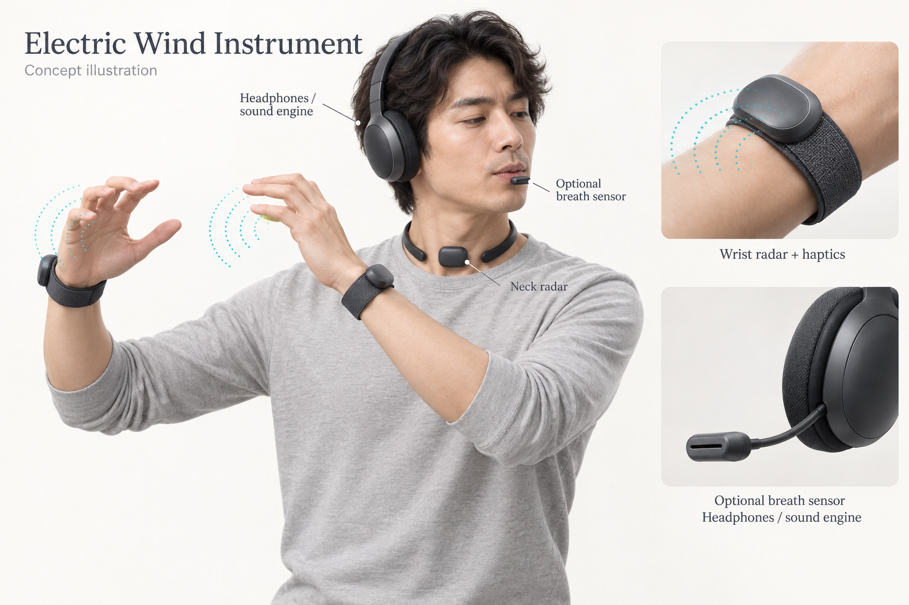

# Electric Wind Instrument

**Status:** Idea record only. No development requested.
**Recorded:** 12 October 2026.

## Electric Wind Instrument Concept (Short Summary)

**Core idea:** A silent, wearable electric wind instrument (starting with flute) that senses finger positions and breath without requiring a full physical instrument. Players hear the sound through headphones for silent practice or performance.

**Finger sensing:**

- One 60 GHz mmWave radar per wrist (Soli-style) reads individual finger bend/position from a short distance. No rings or gloves needed.
- Three radars total: left wrist, right wrist, and neck.
- Works for flute (near 1:1 finger-to-hole). For saxophone and clarinet, track finger combinations; handle octave/register keys, mechanical rings, and alternate fingerings in software.

**Breath / embouchure sensing:**

- Preferred high-fidelity option: small external mouthpiece (tube or boom-mic style clip on existing headphones) with differential pressure sensor + airflow sensing for pressure, flux, and angle of attack.
- Casual / invisible option: neck-mounted 60 GHz radar infers breath effort, jaw/lip geometry, and articulation from throat and surface motion (inspired by sleep-monitoring radars that track chest rise through blankets).
- Silent practice is a primary use case — full technique, zero acoustic sound.

**Communication:**

- Proprietary 2.4 GHz radio link (nRF24L01-style) between sensors and headset/sound engine for low latency (~2–3 ms). Avoids Bluetooth SIG fees.
- Wrist hub or headset merges finger + breath data into sound.

**Other notes:**

- Mouthpiece can be swappable for different instruments (flute, clarinet reed, etc.).
- Haptic feedback on wristbands compensates for missing physical key feel.
- Neck radar can act as master timing reference.
- Same radar hardware used in different modes (fast finger tracking vs. slow micro-motion).

Concept evolved from rings + mouthpiece → wrist/neck radars → optional precision mouthpiece + silent headset practice.

## Concept illustration

Created on 13 October 2026 to visualize the wearable flute configuration.

The [generation prompt](illustrations/PROMPTS.md) is retained for future revisions.
