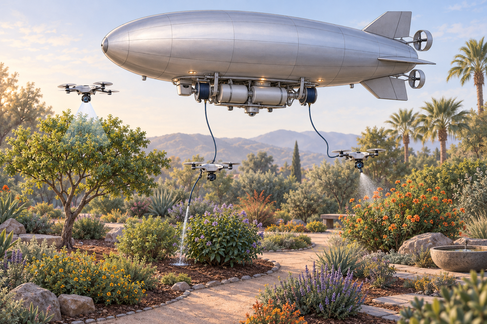
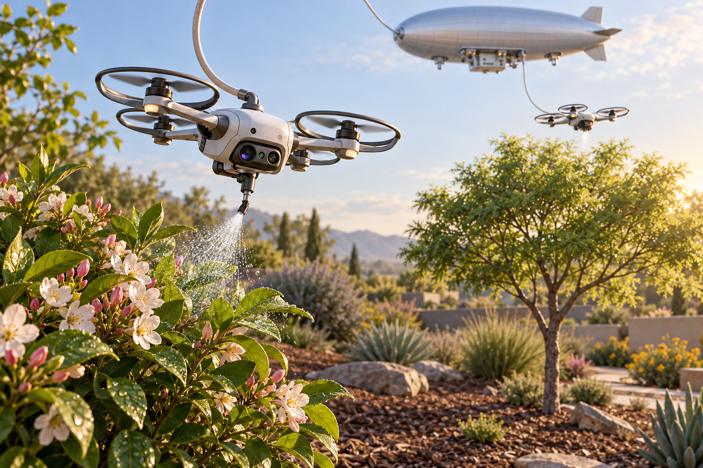
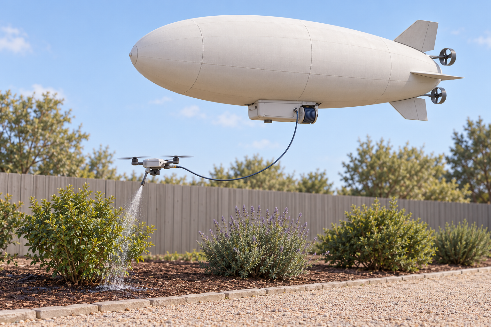
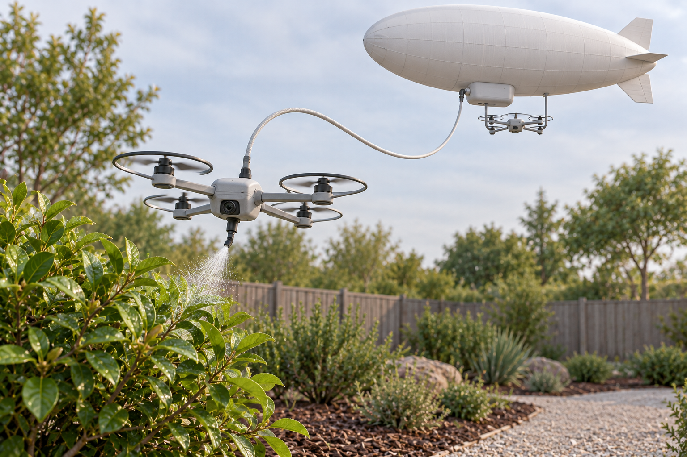
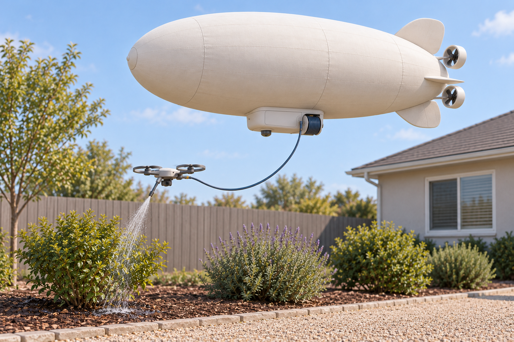
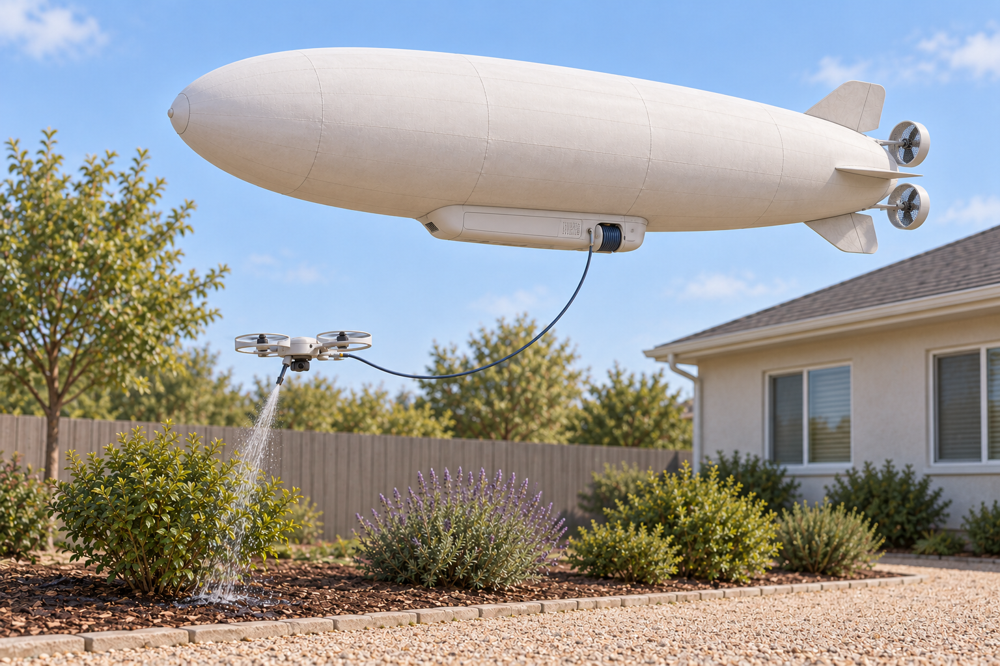
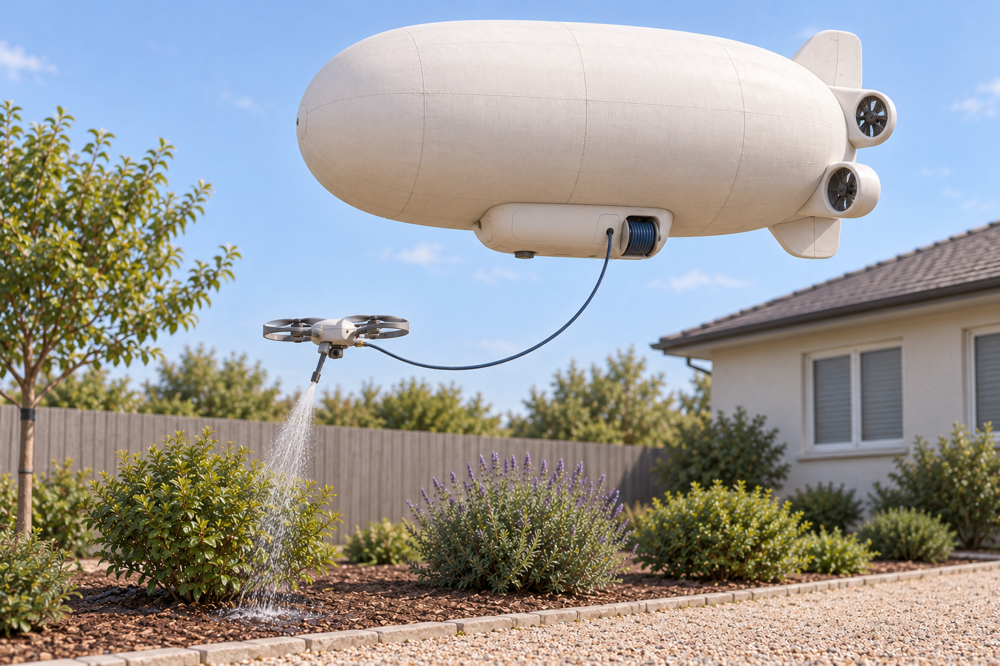

# Mothership Irrigation

**Status:** Idea record only. No development requested.
**Recorded:** 11 October 2026.

## Plant-health service concept (arid gardens) — final version from discussion

This is the consolidated version of the idea as it stood at the end of the discussion.

### Core idea

A subscription service that gives continuous, precise attention to individual plants in gardens and compounds where drip irrigation is hard or incomplete. The product is diagnosis + targeted action (water, pest/disease spray, foliar feed), not hardware sales. It competes with weekly gardeners by checking every plant daily and acting only where needed.

### Architecture (evolved)

- **Ground support vehicle** (4x4 or similar, autonomous or semi-autonomous): carries water, chemical tanks, pumps, power, and plumbing. It is the heavy logistics base.
- **Lightweight nozzle platform** (drone preferred): carries only sensors + a nozzle. It does not carry the payload. It receives water/chemicals from the ground vehicle (hose, cable, or wireless-triggered feed) and applies them.
- Optional **ground robot** for tight, tangled, or low-canopy areas where a flying platform cannot safely get close.
- Advanced variant (the “cool” one): a small blimp / airship mothership floating above the gardens, acting as the mobile base. Drones launch from it. This removes most ground-navigation complexity. (Flying Whales LCA60T is far too large; a garden-scale blimp is open territory. Tethered aerostat is the simpler fixed-hover alternative.)

### Diagnosis

Three sensors are enough for ~85–90 % of practical cases:

- RGB (visible symptoms)
- Multispectral (chlorophyll, vigor, structure)
- Thermal (early water and biotic stress via leaf temperature / CWSI before visible symptoms)

Models pre-train on open data (PlantVillage, PlantDoc, PDD, Zenodo UAV multispectral/thermal sets) and fine-tune on desert ornamental data from the operating environment (the main gap). Accuracy drops from lab (~95–99 %) to field (~70–85 %). The service reports both what it can treat and what it cannot (e.g., root rot needs drainage), turning diagnosis itself into part of the product.

### Application

Three primary compounds cover the bulk of common needs:

- Broad fungicide (copper or sulfur) — powdery mildew, leaf spot, blight
- Insecticide (e.g. imidacloprid or lambda-cyhalothrin) — aphids, whiteflies, mealybugs, scale
- Miticide — spider mites (common in heat/dry conditions)

Plus foliar feed (and optionally a bloom/growth product) for visible health and beauty. Separate tanks/nozzles or a multi-port nozzle system to avoid cross-contamination. Root rot and some bacterial issues are not spray-fixable and are reported to the owner.

### Operations

- Once daily, early morning (thermal window roughly 6–9 am).
- Drone flies above the canopy (nadir + orbit flights); does not enter dense foliage.
- Robot or ground vehicle handles close work.
- Records are stills + metadata + diagnosis, not continuous video. Rough storage estimate: ~0.25 GB per hectare per year compressed (or ~65 MB if only anomalies are stored).
- Client gets notifications and a record of actions and unresolved issues.

### Business model

Drone-as-a-Service / subscription. One operator and vehicle cover a route of gardens. Value is labor savings + daily precision + proof (thermal/multispectral data), not the water itself. Spraying (pest/disease) is the stronger commercial anchor; watering and foliar feeding are supporting services. Hardware cost is dominated by the ground vehicle + plumbing; the nozzle drone itself is cheap. Profitability depends on route density and beating existing gardener rates.

### Constraints & open points

- Wind: intermittent; mothership or operations pause during strong wind.
- Garden weight / soil compaction from ground vehicles.
- Local data collection needed for reliable diagnosis on desert ornamentals and palms.
- Nozzle-only drone + ground feed is the practical simplification; full payload on the drone is unnecessary.

## Concept illustrations

Created on 12 October 2026 to visualize the airship variant of the idea.

The [generation prompts](illustrations/PROMPTS.md) are retained for future revisions.

### Simpler versions

These versions simplify the visible hardware and garden setting while keeping a realistic appearance.

The [prompts for these versions](illustrations/PROMPTS-SIMPLE-V2.md) are also retained.

### Residential design variations

These three concepts explore silhouettes and tidy equipment that feel approachable beside homes. **C — soft capsule airship** has been selected as the visual basis; dimensions and hardware are still undecided.

**A — Rounded fabric blimp**

**B — Slender airship with protected fans**

**C — Soft capsule airship**

The [residential design prompts](illustrations/PROMPTS-RESIDENTIAL-V3.md) are retained for further variations.

## Preliminary capacity estimate

The [first capacity estimate](CAPACITY_ESTIMATE.md) records assumptions, component mass allowances, and lifting calculations for the C-shaped airship. Its central 8 m × 4 m envelope estimate allows approximately 10–20 L of onboard liquid after hardware and a sizing allowance. This remains a concept estimate: controlling buoyancy as liquid is dispensed is an unresolved part of the design.

The [illustrated capacity report](MOTHERSHIP_IRRIGATION_FAST_ESTIMATES.pdf) presents these **fast preliminary estimates** in a three-page PDF, with size comparisons, component weights, assumptions and operating limitations. Its [editable LaTeX source](MOTHERSHIP_IRRIGATION_FAST_ESTIMATES.tex) is retained alongside it.
